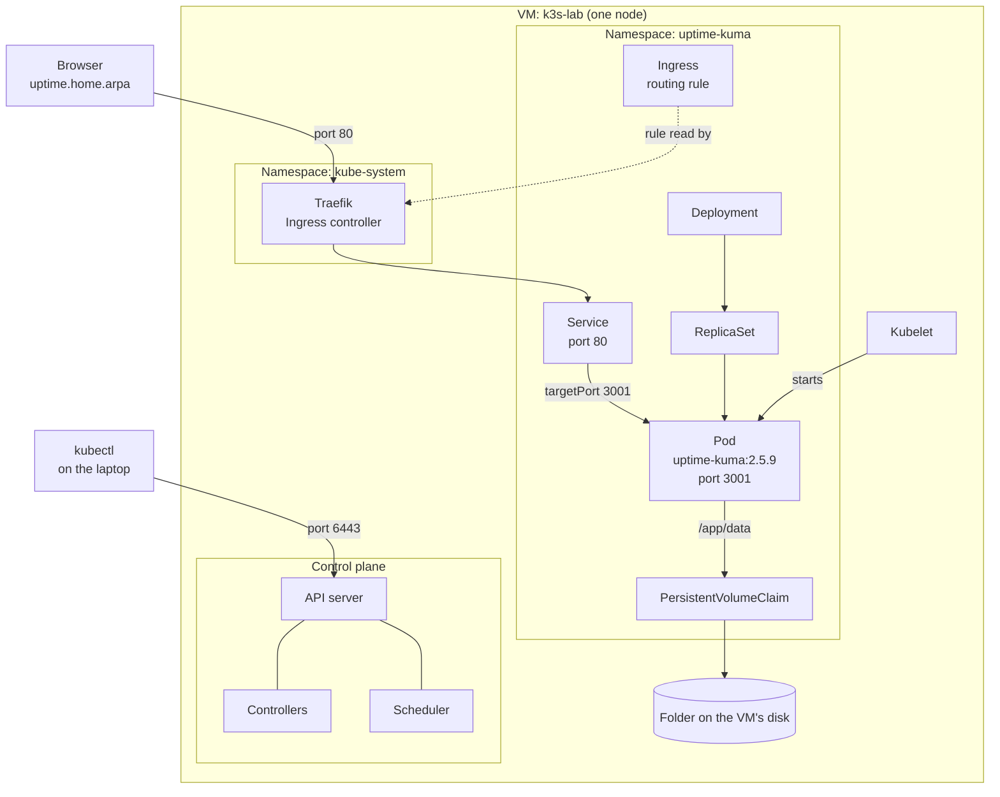

# Lesson 1: Uptime Kuma on k3s

Uptime Kuma is a self-hosted status page. This lesson deploys it by hand on a one-node k3s cluster, adding one Kubernetes concept at a time.

The manifests are in [`kubernetes/uptime-kuma/`](../../../kubernetes/uptime-kuma/). Writing and applying them by hand shows what a GitOps tool like ArgoCD automates later.

## What gets built

| File | Object | Job |
|---|---|---|
| `00-namespace.yaml` | Namespace | Groups the app's objects |
| `deployment.yaml` | Deployment | Keeps one Pod running, with health checks and resource limits |
| `pvc.yaml` | PersistentVolumeClaim | Keeps the app's data when the Pod is replaced |
| `service.yaml` | Service | Gives the Pod a stable name and address |
| `ingress.yaml` | Ingress | Routes `uptime.home.arpa` to the Service |

## How it fits together



**A web request** starts with the laptop's `/etc/hosts` file turning `uptime.home.arpa` into the VM's IP. The browser connects to port 80 on the VM, where k3s's ServiceLB exposes Traefik. Traefik matches the name against the Ingress rule, uses the Service to find the Pod, and connects to the container on port 3001.

**A `kubectl apply`** goes to the API server, which saves the object. The Deployment controller creates a ReplicaSet, the ReplicaSet controller creates a Pod, the scheduler picks a node, and the kubelet on that node starts the container.

## Build it

### Prepare the cluster

1. Create an Ubuntu Server 24.04 VM on Proxmox with 2 CPUs, 4 GB RAM and a 32 GB disk. In the installer, enable OpenSSH and leave every snap unselected.
2. Copy your SSH key to it, then install k3s. Replace `you` and `192.168.1.50` with your own values.

   ```bash
   ssh-copy-id you@192.168.1.50
   ssh -t you@192.168.1.50 'curl -sfL https://get.k3s.io | sh -s - --write-kubeconfig-mode 644'
   ```

   Mode `644` makes the admin credentials readable by any user on the VM. It's acceptable on a throwaway lab VM only.

3. Copy the kubeconfig to your laptop and point it at the VM.

   ```bash
   mkdir -p ~/.kube
   ssh you@192.168.1.50 cat /etc/rancher/k3s/k3s.yaml > ~/.kube/k3s-lab.yaml
   sed -i '' 's/127.0.0.1/192.168.1.50/' ~/.kube/k3s-lab.yaml   # macOS syntax
   export KUBECONFIG=~/.kube/k3s-lab.yaml
   kubectl get nodes
   ```

### Deploy the app

From the root of this repository, apply the whole folder. `kubectl` reads files alphabetically, so the `00-` prefix creates the namespace first.

```bash
kubectl apply -f kubernetes/uptime-kuma/
kubectl get pods,service,ingress,pvc -n uptime-kuma
```

Add the name to your laptop until there's local DNS:

```bash
sudo sh -c 'echo "192.168.1.50 uptime.home.arpa" >> /etc/hosts'
```

Then open <http://uptime.home.arpa>. The connection is plain HTTP, so use a password unique to this app.

## Manifests

<details>
<summary><code>00-namespace.yaml</code></summary>

```yaml
apiVersion: v1
kind: Namespace
metadata:
  name: uptime-kuma
```

</details>

<details>
<summary><code>deployment.yaml</code></summary>

```yaml
apiVersion: apps/v1
kind: Deployment
metadata:
  name: uptime-kuma
  namespace: uptime-kuma
spec:
  replicas: 1
  strategy:
    type: Recreate             # SQLite must not have two writers during an update
  selector:
    matchLabels:
      app: uptime-kuma
  template:
    metadata:
      labels:
        app: uptime-kuma
    spec:
      containers:
        - name: uptime-kuma
          image: louislam/uptime-kuma:2.5.9
          ports:
            - containerPort: 3001
          startupProbe:            # allow up to 150 seconds to start
            httpGet:
              path: /
              port: 3001
            periodSeconds: 5
            failureThreshold: 30
          readinessProbe:          # only send traffic when this passes
            httpGet:
              path: /
              port: 3001
            periodSeconds: 10
          livenessProbe:           # restart after 3 failures in a row
            httpGet:
              path: /
              port: 3001
            periodSeconds: 30
            failureThreshold: 3
          resources:
            requests:
              cpu: 50m
              memory: 128Mi
            limits:
              memory: 512Mi
          volumeMounts:
            - name: data
              mountPath: /app/data
      volumes:
        - name: data
          persistentVolumeClaim:
            claimName: uptime-kuma-data
```

</details>

<details>
<summary><code>pvc.yaml</code></summary>

```yaml
apiVersion: v1
kind: PersistentVolumeClaim
metadata:
  name: uptime-kuma-data
  namespace: uptime-kuma
spec:
  storageClassName: local-path # a folder on the node's disk
  accessModes:
    - ReadWriteOnce            # mounted read-write by one node at a time
  resources:
    requests:
      storage: 1Gi             # local-path doesn't enforce this as a limit
```

</details>

<details>
<summary><code>service.yaml</code></summary>

```yaml
apiVersion: v1
kind: Service
metadata:
  name: uptime-kuma       # also becomes its DNS name
  namespace: uptime-kuma
spec:
  type: ClusterIP         # internal only
  selector:
    app: uptime-kuma      # send traffic to Pods with this label
  ports:
    - port: 80            # the port clients connect to on the Service
      targetPort: 3001    # the port the container listens on
```

</details>

<details>
<summary><code>ingress.yaml</code></summary>

```yaml
apiVersion: networking.k8s.io/v1
kind: Ingress
metadata:
  name: uptime-kuma
  namespace: uptime-kuma
spec:
  ingressClassName: traefik    # which controller follows these rules
  rules:
    - host: uptime.home.arpa   # match requests for this name
      http:
        paths:
          - path: /            # match every URL under this name
            pathType: Prefix
            backend:
              service:
                name: uptime-kuma  # send to this Service
                port:
                  number: 80       # the Service's port, not the container's
```

</details>

## Vocabulary

| Term | Meaning |
|---|---|
| Image | A packaged, read-only copy of an app and what it needs |
| Container | A running, isolated process started from an image |
| Pod | The smallest thing Kubernetes runs: one or more containers sharing a network address |
| Node | A machine in the cluster |
| Object | A record in the cluster describing something you want |
| Manifest | A YAML file describing one or more objects |
| Namespace | A named group that keeps objects separate |
| Label | A `key: value` tag on an object |
| Selector | A filter that finds objects by their labels |
| ReplicaSet | Keeps a set number of identical Pods running |
| Deployment | Manages ReplicaSets to handle updates and rollbacks |
| Controller | A loop that compares desired state with actual state and fixes differences |
| API server | The front door to the cluster; every request goes through it |
| Scheduler | Chooses a node for each new Pod |
| Kubelet | The agent on each node that runs the Pods assigned to it |
| Volume | Storage attached to a Pod that can outlive its containers |
| PersistentVolume (PV) | An actual piece of storage in the cluster |
| PersistentVolumeClaim (PVC) | A request for storage that a Pod can use |
| StorageClass | How storage gets created; k3s includes `local-path` |
| Service | A stable name and virtual IP in front of a group of Pods |
| Endpoints | The Pod IPs behind a Service, stored in EndpointSlices |
| Ingress | Web routing rules; only a record until a controller acts on it |
| Ingress controller | The program that follows those rules; k3s includes Traefik |
| Startup probe | Gives a slow app time to start before the other probes run |
| Readiness probe | Decides whether a Pod should get traffic |
| Liveness probe | Decides whether a stuck container should be restarted |
| Request | CPU or memory reserved for a container when scheduling |
| Limit | The maximum a container may use; exceeding the memory limit kills it |

## Experiments

| Change | What happens | What it shows |
|---|---|---|
| Delete the Pod, with no volume | A new Pod appears, but the account is gone | Kubernetes replaces Pods, not their data |
| Delete the Pod, with a PVC | A new Pod appears and the account remains | Data outlives the container on a volume |
| Delete the Deployment, keep the PVC, re-apply | The account remains | The new Pod claims the same storage by name |
| Set the Service selector to `app: wrong` | The Pod stays healthy, but the Service has no endpoints | Services find Pods only through labels |
| Send a request to Traefik without a matching host | Traefik returns `404` | Ingress routes by the requested name |
| Point the readiness probe at the wrong port | `READY 0/1`, no restarts, no traffic | Readiness only controls traffic |
| Set the memory request and limit to `32Mi` | `OOMKilled`, climbing restarts, `CrashLoopBackOff` | Limits are enforced by killing the container |
| Delete the namespace and re-apply the folder | The app returns with empty data | Manifests rebuild configuration, not data |

## Troubleshooting

| Symptom | Cause and fix |
|---|---|
| `kubectl` says `connection refused` on port 6443 | The API server isn't up. Run `systemctl show k3s -p NRestarts` on the VM and read `journalctl -u k3s`. |
| k3s restarts repeatedly with `bind: address already in use` on port 10257 | Something else holds the port. Check `sudo ss -ltnp \| grep 10257` and `snap list`. If MicroK8s was selected in the Ubuntu installer, run `sudo snap remove --purge microk8s` and reboot. |
| Root disk is only 15 GB on a 32 GB VM | The installer's LVM default left space unallocated. Run `sudo lvextend -r -l +100%FREE /dev/ubuntu-vg/ubuntu-lv`. |
| A Service doesn't respond | Run `kubectl get endpointslices -n <namespace>`, and compare the Service's selector with the Pod's labels. |
| A Pod is `0/1` but has no restarts | The readiness probe is failing. Run `kubectl describe pod`. |
| Restarts keep climbing | The container keeps dying. Check `Last State` in `kubectl describe pod`, and run `kubectl logs --previous`. |

## Limits of this setup

- **Data lives only on this VM's disk.** Deleting the PVC deletes it, and nothing backs it up yet.
- **The Pod is tied to this node.** `local-path` storage doesn't follow a Pod to another node.
- **The status page shares the hardware it monitors.** If the Proxmox host goes down, Uptime Kuma goes down too.
- **There's no HTTPS yet.** Traffic to the app isn't encrypted.

## Next

AdGuard Home provides ad blocking and local DNS to replace the `/etc/hosts` edit, and introduces ConfigMaps, Secrets and a LoadBalancer Service using UDP.
