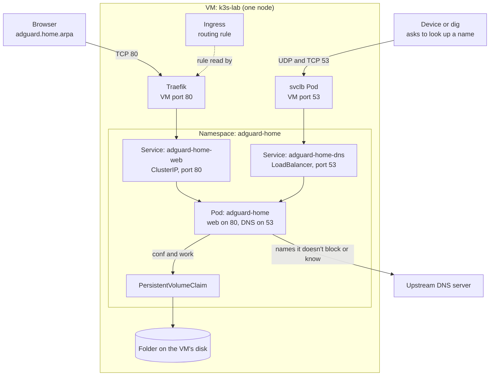

# Lesson 2: AdGuard Home on k3s

AdGuard Home blocks ads and trackers at the DNS level, and answers for local names like `uptime.home.arpa`. This lesson deploys it on the one-node k3s cluster from [Lesson 1](../01-uptime-kuma/README.md).

It adds something Lesson 1 didn't have: one app offering two different services. The web interface is HTTP and goes through Traefik. DNS isn't HTTP, so it needs its own way in.

The manifests are in [`kubernetes/adguard-home/`](../../../kubernetes/adguard-home/).

## What gets built

| File | Object | Job |
|---|---|---|
| `00-namespace.yml` | Namespace | Groups the app's objects |
| `deployment.yml` | Deployment | Runs one Pod, with health checks and resource limits |
| `pvc.yml` | PersistentVolumeClaim | Keeps settings and logs, using one volume for two paths |
| `service-dns.yml` | Service (LoadBalancer) | Exposes DNS to the network on port 53 |
| `service-web.yaml` | Service (ClusterIP) | Gives Traefik a stable way to reach the web interface |
| `ingress.yaml` | Ingress | Routes `adguard.home.arpa` to the web Service |

## How it fits together



**Why two Services?** They serve different audiences. Web requests include a site name, so Traefik can share port 80 between many apps. DNS queries aren't HTTP, so an Ingress can't route them, and they need a LoadBalancer Service with port 53 to itself.

**What happens to a DNS query:**

1. AdGuard checks the name against its DNS rewrites and blocklists.
2. A rewrite returns the address you chose.
3. A blocked name returns `0.0.0.0`, so the device can't connect to it.
4. Anything else goes to an upstream DNS server, and the answer is passed back.

## TCP and UDP

| | TCP | UDP |
|---|---|---|
| Works like | A phone call | A postcard |
| Setup | Both sides connect first | None |
| Lost data | Resent automatically | Lost, unless the app asks again |
| Used for | Web pages, `kubectl` | Most DNS lookups |

DNS uses UDP for nearly everything, and falls back to TCP when an answer is too large. They're separate doors that share the number 53, so the manifests list the port twice. Kubernetes assumes TCP unless `protocol: UDP` is written.

## Build it

### Deploy

Replace `192.168.1.50` with your VM's IP in the commands below.

```bash
kubectl apply -f kubernetes/adguard-home/
kubectl get pods,pvc -n adguard-home
```

### Run the setup wizard

Before setup, AdGuard serves only the wizard on port 3000. The wizard saves your choices to `conf/AdGuardHome.yaml`, then closes port 3000 and starts serving on the ports you picked.

```bash
kubectl port-forward -n adguard-home deployment/adguard-home 3000:3000
```

At <http://localhost:3000>, set the admin web interface to port `80` and the DNS server to port `53`, both on all interfaces. Save the login in a password manager.

The final dashboard link won't work through this tunnel. Press Ctrl+C and use the new port:

```bash
kubectl port-forward -n adguard-home deployment/adguard-home 8080:80
```

Finish the wizard within 10 minutes. The startup probe waits for DNS, which doesn't run until setup is done.

### Test DNS

```bash
dig @192.168.1.50 example.com +short       # real addresses
dig +tcp @192.168.1.50 example.com +short  # the same, over TCP
dig @192.168.1.50 doubleclick.net +short   # 0.0.0.0 means blocked
```

### Add local names

Through the `8080:80` tunnel, go to **Filters > DNS rewrites** and add `*.home.arpa` with your VM's IP as the answer. Every app behind Traefik shares that address, and Traefik picks the app by name, so new apps need no further DNS changes.

Then tell the Mac to use AdGuard for those names only. Other lookups don't change, so a cluster outage only affects homelab names.

```bash
sudo mkdir -p /etc/resolver
echo 'nameserver 192.168.1.50' | sudo tee /etc/resolver/home.arpa
dscacheutil -q host -a name adguard.home.arpa
```

The file's name, `home.arpa`, says which names the rule covers, and its content says which server to ask. Use `dscacheutil` to test this, because `dig` ignores `/etc/resolver`.

### Back up the settings

AdGuard rewrites `AdGuardHome.yaml` whenever a setting changes, and a mounted ConfigMap is read-only, so the file lives on the volume. It holds the password hash, so keep the backup out of Git.

```bash
mkdir -p ~/k3s-lab/backups
kubectl exec -n adguard-home deployment/adguard-home -- cat /opt/adguardhome/conf/AdGuardHome.yaml > ~/k3s-lab/backups/AdGuardHome.yaml
chmod 600 ~/k3s-lab/backups/AdGuardHome.yaml
```

### Try one device

On an iPhone on home Wi-Fi, go to **Settings > Wi-Fi > ⓘ > Configure DNS > Manual** and use only the VM's IP. All of that phone's lookups on that network then go through AdGuard. Set it back to **Automatic** to undo it.

## Health checks

AdGuard's image has no built-in health check, and its behaviour changes after setup, so each probe is chosen for that.

| Probe | Check | Why |
|---|---|---|
| Startup | TCP port 53 open, for up to 10 minutes | Leaves time to finish the wizard on a fresh install |
| Readiness | TCP port 53 open | DNS is the main job. Kubernetes has no UDP probe, so TCP stands in |
| Liveness | `/login.html` responds | Restarts the app if it stops responding |

The cost of the long startup window is that a real startup failure takes up to 10 minutes to be acted on.

## Vocabulary

Terms from [Lesson 1](../01-uptime-kuma/README.md#vocabulary) aren't repeated.

| Term | Meaning |
|---|---|
| DNS | The system that turns names into IP addresses |
| Upstream DNS server | The server AdGuard asks about names it can't answer itself |
| DNS rewrite | A custom AdGuard entry that answers a name with an address you choose |
| Port | A numbered door on an address, so one IP can offer several services |
| `subPath` | Mounts one subfolder of a volume, so one PVC can serve several paths |
| LoadBalancer Service | A Service that also gets an address outside the cluster |
| ServiceLB | The k3s feature that provides that address using a node's own IP |
| `svclb` Pod | A small Pod ServiceLB runs to forward a node's port to a Service |
| Named port | A name for a container port that Services and probes can refer to |
| `tcpSocket` probe | Passes if a port accepts a TCP connection |

## Experiments

| Change | Result | What it shows |
|---|---|---|
| Delete the Pod after setup | The login page returns, not the wizard | Settings live on the volume |
| Query `doubleclick.net` | `0.0.0.0` | Blocking happens in the DNS answer |
| Scale to zero replicas and query | `dig` times out | With no Pod, nothing answers, so depending on one Pod is risky |
| Check the query log's Client column | A `10.42` address, not the device | ServiceLB hides the sender's address |
| Request the web interface with the right `Host` | `302` | The chain from Traefik to the Pod works |

## Troubleshooting

| Symptom | Cause and fix |
|---|---|
| The dry run passes but the site doesn't work | Check that the Ingress backend's name exactly matches the Service. Each file is valid alone, so validation can't catch a mismatch. |
| `dig @<ip> <name>` works but apps can't find the name | `dig` skips `/etc/resolver`. Test with `dscacheutil`, and clear the cache with `sudo dscacheutil -flushcache; sudo killall -HUP mDNSResponder`. |
| A `*` path on the VM says no such file | The shell expands the wildcard before `sudo` runs. Wrap it: `sudo sh -c 'ls /var/lib/rancher/k3s/storage/*adguard*'`. |
| The wizard's port stops working | That's expected after setup. Use the port you chose in the wizard. |

## Limits of this setup

- **One Pod means one point of failure.** Don't point the router at AdGuard until there's a worker node and a tested backup.
- **Restoring the backup hasn't been tested.** A backup isn't proven until it has been restored.
- **Every client appears as a `10.42` address.** Real device addresses usually need `hostNetwork: true` and freeing port 53 on the VM.
- **Don't point the VM's own DNS at AdGuard.** The cluster needs DNS while AdGuard is restarting.
- **Never forward port 53 from the internet to this VM.**
- **The web interface is plain HTTP.** Traffic to it isn't encrypted.

## Next

Add a second VM as a worker to learn scheduling, `kubectl drain`, and why a Pod using local storage can't simply move to another node.
