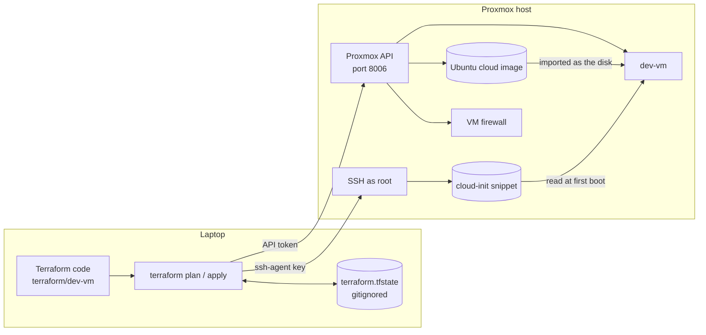
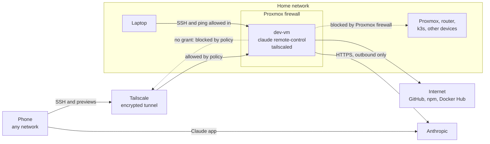

# Side lesson: Dev VM with Terraform

A development VM on Proxmox, built entirely with Terraform, for coding with Claude Code from a phone on any network. It's separate from the Kubernetes lessons: the VM isn't part of the cluster and can't reach the home network.

The code is in [`terraform/dev-vm/`](../../../terraform/dev-vm/).

## Status

| Part | Topic | Status |
|---|---|---|
| 1 | Terraform foundations | Done |
| 2 | First VM from code | Done |
| 3 | Variables, outputs and cloud-init | Done |
| 4 | Network isolation | Done |
| 5 | Claude Code and Remote Control | Set up. A first project run from the phone is still to confirm. |
| 6 | Tailscale | Done |
| 7 | Rebuild drill and backups | Not started |

## What gets built

| File | Resource | Job |
|---|---|---|
| `main.tf` | `proxmox_download_file.ubuntu` | Downloads a dated Ubuntu 24.04 cloud image to Proxmox and checks its SHA-256 |
| `main.tf` | `proxmox_virtual_environment_file.user_data` | Fills in the cloud-init template and stores it on Proxmox as a snippet |
| `main.tf` | `proxmox_virtual_environment_vm.dev` | The VM: 4 CPUs, 6 GB RAM, 64 GB disk, fixed IP, guest agent |
| `firewall.tf` | `proxmox_virtual_environment_firewall_options.dev` | Turns on the VM's firewall: incoming dropped, outgoing allowed |
| `firewall.tf` | `proxmox_virtual_environment_firewall_rules.dev` | SSH and ping in from home, no new connections out to private networks |
| `templates/user-data.yaml.tftpl` | | First-boot setup: user, packages, Docker, mise, Node 26, pnpm, uv, GitHub CLI |
| [`tailscale/policy.hujson`](../../../tailscale/policy.hujson) | | Reference copy of the tailnet access policy. The live copy is in the Tailscale admin console. |

## How it fits together

### Building the VM



Terraform talks to Proxmox two ways. Most work goes through the API with a scoped token. Snippets can't be uploaded through the API, so the provider uses SSH as root for those, with the key held in the laptop's ssh-agent.

### Using the VM



There are two separate paths from the phone. Claude Code goes through Anthropic, with both sides connecting out, so no ports are open on the router. The terminal and previews go through Tailscale's encrypted tunnel, which also connects outward.

Each path out of the VM has its own guard, because neither can see the other's traffic:

| Path | Enforced by |
|---|---|
| VM to the home network, directly | Proxmox firewall |
| VM to your devices, through the tunnel | Tailscale policy. Proxmox only sees encrypted UDP to the internet. |

## One-time Proxmox setup

Run these in **pve01 > Shell**.

**Storage.** The `local` storage must accept cloud images and snippets. This replaces the whole list, so keep the types it already has:

```bash
grep -A4 '^dir: local$' /etc/pve/storage.cfg
pvesm set local --content iso,vztmpl,backup,import,snippets
```

**User, roles and token.** Permissions were added only as each part needed them, so each one has a reason:

```bash
pveum user add terraform@pve

pveum role add TerraformDevVM -privs "Datastore.AllocateTemplate,Datastore.Audit,Sys.Audit,Sys.Modify,VM.Allocate,VM.Audit,VM.Config.CDROM,VM.Config.CPU,VM.Config.Cloudinit,VM.Config.Disk,VM.Config.HWType,VM.Config.Memory,VM.Config.Network,VM.Config.Options,VM.PowerMgmt,VM.Monitor,Datastore.AllocateSpace,SDN.Use"
pveum role add TerraformDevVMSnippets -privs "Datastore.Allocate"

pveum aclmod / -user terraform@pve -role TerraformDevVM
pveum aclmod /storage/local -user terraform@pve -role TerraformDevVM
pveum aclmod /storage/local -user terraform@pve -role TerraformDevVMSnippets

pveum user token add terraform@pve dev-vm --privsep 0
```

| Permissions | Needed for |
|---|---|
| `Datastore.AllocateTemplate`, `Sys.Audit`, `Sys.Modify` | Downloading an image from a URL |
| `Datastore.Audit`, `Datastore.AllocateSpace` | Listing storage and creating disks |
| `VM.*`, `SDN.Use` | Creating and configuring the VM, and attaching it to `vmbr0` |
| `Datastore.Allocate`, on `/storage/local` only | Uploading the cloud-init snippet |

`Datastore.Allocate` can change storage settings and delete files, so it's granted on one storage, not everywhere. `TerraformDevVM` is granted on `/storage/local` too, because in Proxmox a permission on a more specific path **replaces** what's inherited from `/` for that user. Several roles on the same path combine.

Save the token's secret in a password manager. It's shown once, and it's never pasted into chat, code or files.

**Datacenter firewall.** VM firewalls only work once it's on. It also firewalls the host, and Proxmox keeps the web interface and SSH open from its detected local network. Check that the laptop is on that network first:

```bash
pve-firewall localnet
```

Then turn on **Datacenter > Firewall > Options > Firewall**, and confirm the web interface and `ssh root@<proxmox>` still work from a new tab before closing the old one. If you're ever locked out, run `pve-firewall stop` from the server's own console. Later services on the Proxmox host itself, such as NFS, need a host rule.

## Running Terraform

On the laptop, once:

```bash
brew tap hashicorp/tap && brew install hashicorp/tap/terraform
ssh-copy-id root@192.168.1.10
cp terraform/dev-vm/terraform.tfvars.example terraform/dev-vm/terraform.tfvars   # then edit it
```

In each new terminal:

```bash
ssh-add ~/.ssh/id_ed25519
read -s "TF_VAR_proxmox_api_token?Proxmox token: " && export TF_VAR_proxmox_api_token
cd terraform/dev-vm
terraform init
terraform plan
terraform apply
```

`read -s` keeps the token off the screen and out of shell history. Terraform reads any `TF_VAR_<name>` variable as an input.

## Concepts

| Term | Meaning |
|---|---|
| Provider | A plugin that teaches Terraform one system's API, here `bpg/proxmox` |
| Resource | One thing Terraform manages |
| State | Terraform's record of what it created. It can hold secrets, so it stays out of Git. |
| Lock file | `.terraform.lock.hcl`, which pins the provider's exact version and checksums. It belongs in Git. |
| Drift | Reality no longer matches the code. Terraform only notices when you run `plan` or `apply`. |
| Import | Records something that already exists as managed by the code, without changing it |
| `locals` | Values calculated inside the code |
| `output` | Values printed after `apply` |
| cloud-init | Sets up a new VM at its first boot only, from the snippet Proxmox attaches |
| Stateful firewall | Replies to an allowed connection are let through automatically |

**Reading a plan:**

| Symbol | Meaning |
|---|---|
| `+` | Create |
| `~` | Update in place, keeping the same VM and disk |
| `-/+` | Replace: destroy, then create. Everything on the old disk is lost. |
| `# forces replacement` | The setting that makes a replacement necessary |

## Experiments

| Change | Result | What it shows |
|---|---|---|
| Run `plan` twice | The second says `No changes` | Terraform compares code with reality, so repeating it is safe |
| Delete the image by hand, then `plan` | Plans to create it again | Drift is only fixed when you run Terraform |
| Change memory | `~` update in place | Some settings can change on a running VM |
| `apply -replace` after writing a file on the VM | The file is gone | The VM's disk is disposable. Keep work in Git. |
| Change the cloud-init template | Only takes effect after a replacement | cloud-init runs once per VM |
| From the VM, reach the router and k3s | Refused | The VM can't start connections to the home network |
| SSH from the laptop to the VM | Works | The firewall is stateful, so replies to allowed connections get out |
| SSH from the phone over cellular, through Tailscale | Works with no SSH key | Tailscale SSH trusts the tailnet identity, and the policy allows it |
| Open a web server on port 8080 from the phone over cellular | The page loads | Previews work from anywhere, if the server listens on all addresses |

## Claude Code and Remote Control

On the VM, as the `dev` user:

```bash
curl -fsSL https://claude.ai/install.sh | bash   # then log out and back in
mkdir -p ~/code && cd ~/code
claude                                          # accept trust for ~/code, then sign in
```

Projects live in `~/code`, because Claude Code never remembers trust for a home directory. With no browser on the VM, sign-in shows a link to open on another device.

**GitHub** uses a fine-grained token limited to selected repositories, with **Contents** and **Pull requests** set to read and write:

```bash
gh auth login --with-token   # paste the token, press Enter, then Ctrl+D
gh auth setup-git
```

**The Remote Control server** runs as a systemd user service inside its own tmux session, so it starts at boot and you can attach to see its URL and QR code. `~/.config/systemd/user/claude-remote.service`:

```ini
[Unit]
Description=Claude Code Remote Control server

[Service]
Type=forking
# mise's shims first, so Claude's commands find Node, pnpm, uv and gh
Environment=PATH=%h/.local/share/mise/shims:%h/.local/bin:/usr/local/bin:/usr/bin:/bin
WorkingDirectory=%h/code
# A separate tmux server (-L), so your own tmux sessions aren't affected
ExecStart=/usr/bin/tmux -L claude-rc new-session -d -s claude-rc %h/.local/bin/claude remote-control --spawn same-dir
ExecStop=/usr/bin/tmux -L claude-rc kill-server
Restart=always
RestartSec=10

[Install]
WantedBy=default.target
```

```bash
sudo loginctl enable-linger dev   # run user services at boot, without logging in
systemctl --user daemon-reload && systemctl --user enable --now claude-remote
tmux -L claude-rc attach -t claude-rc   # see the server; Ctrl+B then D to leave
```

Then open **Code** in the Claude app and choose `dev-vm`. Turn on **Require trusted devices** in your claude.ai account settings, so each device must verify itself before it can control a session.

None of Part 5 is in cloud-init yet, so a rebuilt VM needs these steps again. Part 7 covers which can be automated. The logins can't be, because they're secrets.

## Tailscale

**Write the access policy before adding the VM.** Tailscale's default policy lets every device reach every other one, and Proxmox's firewall can't see inside the tunnel. With the default, the VM could reach your laptop and phone, and through any future subnet router, the whole home network.

In the admin console, open **Access controls > JSON editor** and replace the policy with [`tailscale/policy.hujson`](../../../tailscale/policy.hujson). It grants your devices access to each other and to `tag:dev`, and grants `tag:dev` nothing. On the **Policies** page, `tag:dev` should appear only under destinations, never under sources.

Then, on the VM:

```bash
curl -fsSL https://tailscale.com/install.sh | sh
sudo tailscale up --ssh --advertise-tags=tag:dev --hostname=dev-vm --accept-dns=false
tailscale status
```

| Flag | Why |
|---|---|
| `--ssh` | Tailscale SSH, controlled by the policy's `ssh` rules, so the phone needs no SSH key |
| `--advertise-tags=tag:dev` | Joins as a tagged device, so the `tag:dev` rules apply and it isn't treated as one of your own devices |
| `--hostname=dev-vm` | The MagicDNS name, used as `dev-vm` from your devices |
| `--accept-dns=false` | Keeps the VM on the public DNS servers it was built with |

**From the phone,** with the Tailscale app connected:

- **Terminal:** an SSH app pointed at `dev-vm`, user `dev`, no password.
- **Previews:** `http://dev-vm:<port>`. Dev servers such as Vite and Next.js listen only on `localhost` by default, so start them with `--host` or `--hostname 0.0.0.0`.

`tailscale status` shows `direct` or `relay` for each peer. The VM can't reach home addresses, so at home a relay through Tailscale's servers is normal.

## Troubleshooting

| Symptom | Cause and fix |
|---|---|
| `Reference to undeclared input variable` | No `variable` block exists. Terraform reads every `.tf` file in the folder, so check that the blocks are where you expect. |
| `the API token must be in the format 'USER@REALM!TOKENID=UUID'` | Only the secret was set. The token is `terraform@pve!dev-vm=` followed by the secret. |
| `plan` hangs | Either it's waiting at `Enter a value:` for an unset variable, or `proxmox_endpoint` isn't reachable. Test with `curl -sk https://<proxmox>:8006/`. |
| `403 Permission check failed (<path>, <permission>)` | Add that permission at that path. The error names both. |
| `403`s for permissions you already granted | A role on a more specific path replaced the inherited ones. Grant the main role on that path too. |
| State lost track of the image after a failed run | Fix the cause, then `terraform import proxmox_download_file.ubuntu pve01/local:import/<file name>`. |
| A failed `-/+` left no VM | Replacement destroys first. Fix the error and run `apply` again. |
| `REMOTE HOST IDENTIFICATION HAS CHANGED` after a rebuild | Expected, because the new VM has new host keys. Run `ssh-keygen -R <ip>`. |
| `gh auth login --with-token` seems frozen | It's waiting for the token. Paste it, press Enter, then Ctrl+D. |
| A dev server works on the VM but not from the phone | It's listening on `localhost` only. Start it with `--host`, or bind to `0.0.0.0`. |
| Can't find where to preview Tailscale rules | The admin console has changed. On **Access controls > Policies**, check that `tag:dev` never appears as a source. |

## Security notes

- **Secrets stay out of Git and Terraform state.** The Proxmox token lives in an environment variable. The Claude login and the GitHub token are created by hand on the VM.
- **The firewall depends on the datacenter switch.** If the datacenter firewall is turned off, the VM's rules stop applying.
- **IPv6 is effectively off for the VM.** Neighbour discovery isn't enabled in its firewall options, so it shouldn't be able to reach the home network over IPv6 either.
- **`dev` has passwordless `sudo` and is in the `docker` group.** Both amount to root on the VM, which is acceptable because the VM is isolated and disposable. Keep Claude Code in the permission mode that asks first.
- **Whoever controls the Claude account controls the VM.** Remote Control transcripts are stored by Anthropic while connected.
- **Root SSH to Proxmox stays on the laptop.** The dev VM never gets that key.
- **The tunnel needs its own rules.** The Tailscale policy, not the Proxmox firewall, is what stops the VM reaching your devices through Tailscale. Review it whenever you change the tailnet, especially before adding a subnet router.

## Next

- **Part 7:** A Proxmox backup schedule, then destroy and rebuild the VM to see exactly what a rebuild restores, and which steps, such as installing Claude Code and Tailscale, can move into cloud-init. Signing in to Claude, GitHub and Tailscale stays manual, because those are secrets.
